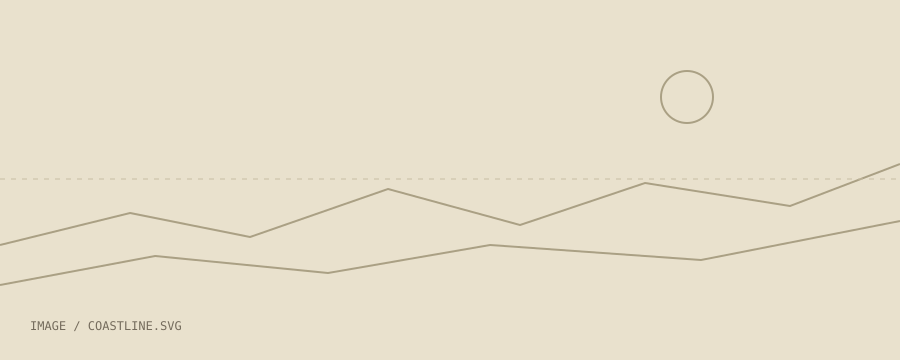

# Coastal walk

The best ideas tend to arrive when there is nothing demanding my attention. Today, that meant a long walk along the water.

## A few things to keep

- Leave space for the unexpected.
- Take fewer photographs. Look a little longer.
- Bring a notebook next time.

> A useful tool makes room for the thing you came to do.

The path reminded me of [the garden project](../Projects/Garden.md): enough structure to find your way, enough freedom to wander.

See also: [Weekend plans](Weekend%20plans.md).
